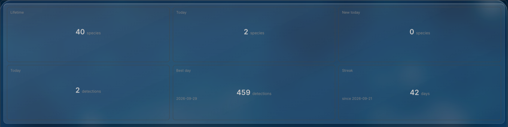
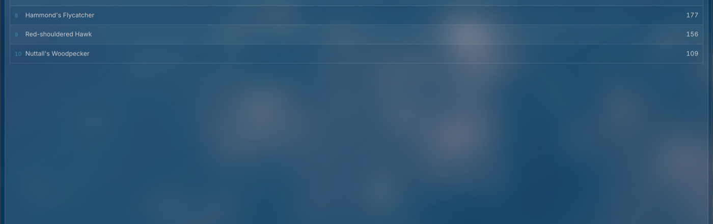
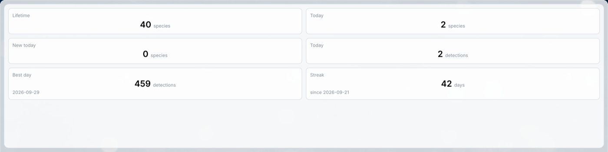
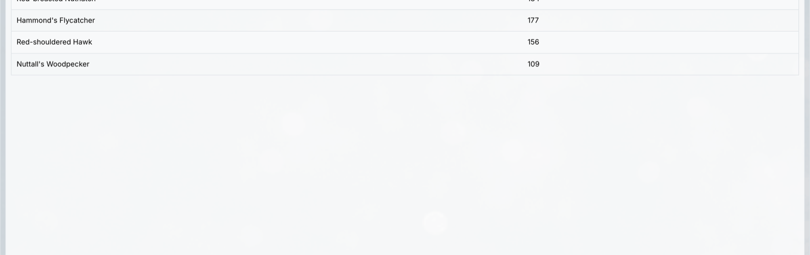

# homarr-birdnet-go

Two custom widgets for [Homarr](https://homarr.dev) 2.x that read
[BirdNET-Go](https://github.com/tphakala/birdnet-go)'s own REST API: a grid of
headline counts, and a top-species table.

```
 ┌──────────────────────┬──────────────────────┐
 │ Lifetime             │ Today                │
 │     16 species       │  1 species  3 detect.│
 ├──────────────────────┼──────────────────────┤
 │ New today            │ Best day             │
 │      0 species       │    459 detections    │
 │                      │    2026-09-29        │
 └──────────────────────┴──────────────────────┘

   SPECIES                          DETECTIONS
   1  Costa's Hummingbird                  962
   2  Black Phoebe                         467
   3  Lesser Goldfinch                     438
```

Dark, on a themed board:





Light, on stock Homarr:





| File | What it shows |
| --- | --- |
| `kpis.json` | Lifetime species, species today, new species today, detections today, best day, current streak, and optional app squares linking your stations |
| `top-species.json` | Most-detected species with counts, or least-detected for a rare-sightings tile; optional confidence and last-heard columns |

Both are complete `homarr-custom-widget-v2` definitions, verified against
Homarr's real JSX interpreter (see [Checking a change](#checking-a-change)).

## Installing

1. Open the file, find `sources.default.baseUrl` and replace
   `http://birdnet-go.local:8080` with the address of your BirdNET-Go
   instance as Homarr's container can reach it. BirdNET-Go answers these
   endpoints without authentication, so the source stays `auth: "none"`.
2. **Management, Custom Widgets.** Either use **Import** (the upload icon at
   the top of the list) and pick the `.json` file, or copy the file's contents
   and press Cmd+V or Ctrl+V anywhere on that page: it has a page-level paste
   listener and no text box. Click into a field first and the paste is
   ignored.
3. Run **Test and preview**, then save.
4. Add the widget to a board. For the KPI widget, the **app squares** also
   need an API key for your own Homarr instance, see below; everything else
   works as is.

| File | Request | Source | Endpoint |
| --- | --- | --- | --- |
| `kpis.json` | `kpis` | BirdNET-Go | `/api/v2/dashboard/kpis` |
| `kpis.json` | `summary` | BirdNET-Go | `/api/v2/analytics/species/summary` with `limit=100` |
| `kpis.json` | `apps` | this Homarr instance | `/api/apps` |
| `top-species.json` | `species` | BirdNET-Go | `/api/v2/analytics/species/summary` with `limit=100` |

### The app squares, and the second source

The KPI widget can show your BirdNET stations as squares after the stats:
icon, name, and a link. It finds them the way
[homarr-tagged-apps](https://github.com/nordada/homarr-tagged-apps) does, by a
keyword you put in each app's **Description** field in Homarr, and reads the
app list from the Homarr instance the widget lives on.

That second source is `http://127.0.0.1:7575` with `networkScope: "loopback"`,
which means "this instance" wherever the file is imported, so the same
definition works on every Homarr you run. Homarr's own API wants an `ApiKey`
header, and the key is never in the definition (the schema rejects a credential
in an export), so after importing, open the widget's **API sources** and enter
a key for the `homarr` source once. Leave **App squares: category** blank and
no request is made to it at all.

## Options

Every option has a description in Homarr's panel. The ones worth knowing
before you start:

**KPI widget.** One switch per stat card, plus **Show today, combined**, which
puts species today and detections today side by side in one card headed Today
and hides the two separate Today cards while it is on. Each card has a
**label** (the heading) and a **unit** (the word after the number, blank to
hide); defaults are Lifetime / species, Today / species, New today / species,
Today / detections, Best day / detections, Streak / days. **Number
alignment** and **Label alignment** are left, centre or right. The app squares
have a category keyword, an optional label styled like the count labels, and
switches for the name, opening in a new tab, and a link glyph. Styling covers
columns, three paddings, borders, radius, number size and two colours.

The three spacing options do different jobs: **Gap** separates the cards,
**Card padding** is inside each card, and **Padding around the grid** is the
space between the grid and the edge of the tile.

**Top-species table.** **Order** is the whole point of having two copies: most
detected first is the usual list, least detected first makes the same widget a
rare-sightings tile. The request asks for up to 100 species and the template
sorts and slices, because the endpoint returns the top N by count and a small
limit would never contain the single-detection species at all. Ties break by
common name so the rare end does not reorder between refreshes. Rows, padding,
detections, confidence, last heard, scientific names, stripes, border, density
and font size are the rest.

Two things the option schema cannot do, which shaped these: select values must
be strings (so `"2"`, converted in the template), and an option cannot hide
itself based on another, so a caption switch stays visible when the cards it
affects are off.

## How the counts are made

- **Lifetime species, detections today, best day and streak** come straight
  from `/api/v2/dashboard/kpis`.
- **Species today and new species today** are not in that endpoint. They come
  from the species summary, which carries `first_heard` and `last_heard` per
  species: today's species are the rows whose `last_heard` date is today,
  new-today species the rows whose `first_heard` date is today. Today is the
  browser's date in `YYYY-MM-DD`, compared against the first ten characters of
  BirdNET's timestamp. BirdNET stamps in the station's time zone and the
  browser supplies today in its own, so a viewer in a distant zone can see the
  count roll over at the wrong hour.
- **Why not Prometheus.** BirdNET-Go also exposes Prometheus metrics, and
  Homarr has a Prometheus integration, but that integration only reports
  scrape-target health and runs no queries. The `birdnet_detections` counter
  would not answer anyway: it is per process and resets on restart, so it
  cannot hold a lifetime total. The REST API is the right source for these
  numbers.

## Checking a change

`tools/sandbox-check.sh` fetches Homarr's `packages/custom-widgets` at any ref,
bundles the real interpreter, and renders a definition through it against the
cases in `<name>-cases.json`, reporting blocked props and dropped values. No
instance needed.

```
bash tools/sandbox-check.sh kpis.json release/v2
bash tools/sandbox-check.sh kpis.json 3aa14e22
bash tools/sandbox-check.sh top-species.json release/v2
```

Run both refs. Before Homarr commit `47f6c1cc` the sandbox implements `==` and
`!=` as string comparison, so `undefined != null` is true and a guard takes the
wrong branch; only `===` and `!==` behave the same on every build, which is why
every test in these templates is strict. The checker proves the template
renders, not that it looks right, so still use **Test and preview**.

## Notes for authors

- Both generations of Homarr's custom-widget schema declare the identical
  `$schema: "homarr-custom-widget-v2"` string. The `main` branch shape is a
  flat `{url, authType, method, displayType}`; the `release/v2` shape, which
  these files use, is a strict object of `sources`, `requests`, `options` and
  `template` and rejects unknown keys. Check the schema on the branch your
  image was built from, not the `$schema` line.
- `sources` must contain a key named `default`; `networkScope` is `public`,
  `private` or `loopback`; a request `path` starts with `/` and takes no query
  string, so parameters go in the request's `query` map; `cacheSeconds` caps
  at 3600.
- The workbench's **Create or fix with any AI** button copies a prompt
  carrying the exact contract and component whitelist for the running build.
- The sandbox's silent-failure rules, blocked props and what spends the render
  budget are written up in the
  [homarr-tagged-apps README](https://github.com/nordada/homarr-tagged-apps);
  they describe the runtime rather than any one widget.

## License

GPL-3.0, see [LICENSE](LICENSE).
